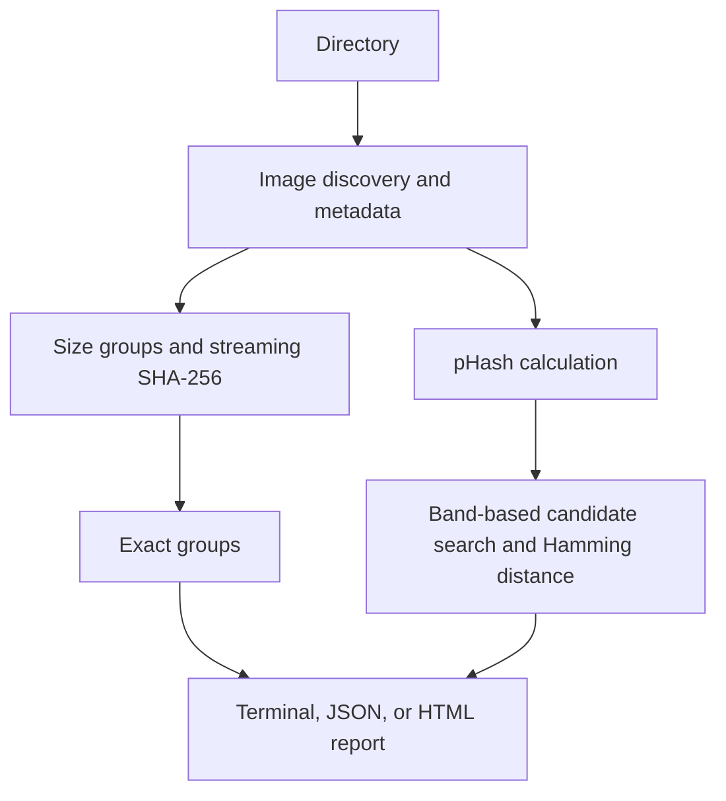

# Duplicate Image Finder

A fast and safe Python CLI for finding exact duplicate and visually similar images in photo collections.

## Features

- SHA-256 exact duplicate detection with streaming file reads
- Perceptual similarity detection with ImageHash pHash
- Recursive scanning, case-insensitive image extensions, and excluded directories
- Concurrent metadata and perceptual hash extraction
- SQLite cache, JSON output, and standalone HTML report
- Optional moving of exact duplicates with a dry-run option
- Read-only by default; near duplicates are never moved

## Demo

Illustrative output (not a scan of a real collection):

```text
Duplicate Image Finder
========================
Scanning: /home/user/Pictures

Images discovered: 120
Images processed:  119
Skipped:           1
Exact duplicate groups: 2
Similar image groups: 3
Potential exact savings: 8,420,000 bytes
```

## How It Works



### Exact vs Similar

Exact duplicates have identical binary content, established by matching file size and SHA-256 digest. Visually similar images merely look alike according to their perceptual hashes. Similar images are not automatically moved because they may be different edits or meaningful variants.

### Similarity

ImageHash computes a perceptual hash after EXIF orientation normalization and RGB conversion. The Hamming distance between 64-bit hashes is converted to an approximate percentage as `100 × (1 − distance / 64)`. This is an approximation, not a computer-vision confidence score. `--similarity` sets the minimum reported score. Similar groups use connected matches; their displayed score is the weakest qualifying link, so every pair in a transitive group is not necessarily that similar.

### Performance and cache

Files are first grouped by size; unique-size files need no exact hashing. Candidate full-file hashes are streamed in chunks. For pHash comparison, the 64 bits are split into seven bands; candidates sharing a band are checked by Hamming distance. This avoids checking every pair and retains every pair within six bit differences, which covers the default 90% threshold. At lower thresholds, this candidate strategy can omit some matches. Independent file analysis and exact hashing use worker threads. SQLite stores metadata and pHashes keyed by absolute path, file size, and modification time; `--no-cache` disables it and `--clear-cache` clears the default cache.

Directory symlinks are not followed. Exclusion names are matched case-insensitively at every level.

## Installation

```bash
git clone https://github.com/YOUR_USERNAME/duplicate-image-finder.git
cd duplicate-image-finder
python -m venv .venv
```

Windows PowerShell: `.venv\Scripts\Activate.ps1`  
Linux/macOS: `source .venv/bin/activate`

```bash
pip install -e .
```

## Usage

```bash
duplicate-images ~/Pictures
python -m duplicate_image_finder ./photos --similarity 95
duplicate-images ./photos --exact-only
duplicate-images ./photos --similar-only --exclude cache --exclude thumbnails
duplicate-images ./photos --no-recursive
duplicate-images ./photos --json
duplicate-images ./photos --html report.html
duplicate-images ./photos --no-cache
duplicate-images ./photos --clear-cache
```

## Safe Cleanup

Normal scans are read-only. Review results and the HTML report, then use `--move-duplicates review/ --dry-run` to inspect a plan. Remove `--dry-run` only when ready to move exact duplicates. One file in each exact group is kept. Target collisions get a numbered filename. Manually inspect the review directory and delete files yourself if desired.

## JSON and HTML reports

`--json` prints machine-readable JSON to stdout. `--html report.html` writes a compact report with escaped filenames and no embedded source images.

## Project Structure

```text
duplicate_image_finder/  CLI, scanner, models, actions, reports
tests/                   Core behavior tests
pyproject.toml            Package and tool configuration
```

## Testing and Development

```bash
python -m pytest
ruff check .
ruff format --check .
```

## What I Learned

Image processing with Pillow, cryptographic and perceptual hashing, Hamming distance, concurrent processing, SQLite caching, filesystem safety, CLI design, HTML escaping, and pytest.

## Limitations

Perceptual similarity is approximate and visually similar does not mean duplicate. Large libraries still require processing time. Corrupted and unsupported files are skipped. Similarity thresholds need judgment; the band candidate strategy can miss pairs below 90% and can approach quadratic work when many images share the same bands.

## Future Improvements

Interactive visual comparisons, image quality ranking, EXIF-aware keeper selection, video matching, and recycle-bin integration.
